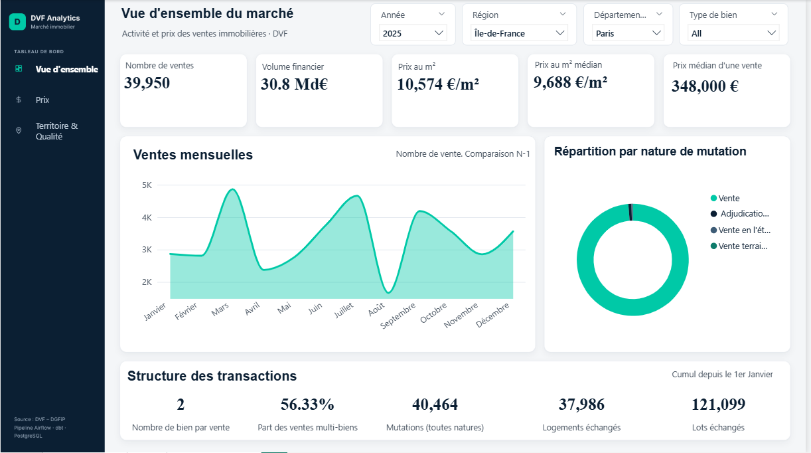
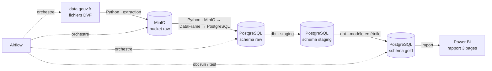
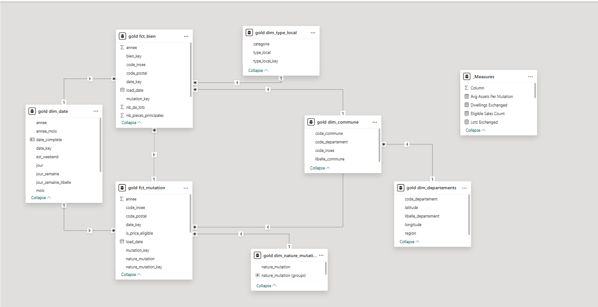

# DVF Analytics — analyse du marché immobilier français avec Power BI

> Pipeline data de bout en bout sur les **Demandes de Valeurs Foncières (DVF)** : de l'open data brut jusqu'à un rapport Power BI d'analyse du marché immobilier français.

Projet personnel d'apprentissage et de portfolio.



*Page 1 du rapport : vue d'ensemble du marché parisien en 2025.*

---

## Sommaire

- [DVF Analytics — analyse du marché immobilier français avec Power BI](#dvf-analytics--analyse-du-marché-immobilier-français-avec-power-bi)
	- [Sommaire](#sommaire)
	- [Objectif](#objectif)
	- [Architecture](#architecture)
	- [Stack technique](#stack-technique)
	- [Structure du dépôt](#structure-du-dépôt)
	- [Démarrage rapide](#démarrage-rapide)
		- [Prérequis](#prérequis)
		- [1. Cloner et configurer](#1-cloner-et-configurer)
		- [2. Lancer les services](#2-lancer-les-services)
		- [3. Environnement Python](#3-environnement-python)
		- [4. Exécuter le pipeline](#4-exécuter-le-pipeline)
	- [Pipeline étape par étape](#pipeline-étape-par-étape)
	- [Modèle de données (constellation)](#modèle-de-données-constellation)
	- [Rapport Power BI](#rapport-power-bi)
		- [Page 1 · Vue d'ensemble du marché](#page-1--vue-densemble-du-marché)
		- [Pages 2 et 3](#pages-2-et-3)
	- [Réalisations et évolutions](#réalisations-et-évolutions)
	- [Conventions](#conventions)
	- [Source des données et licence](#source-des-données-et-licence)
	- [Auteurs](#auteurs)

---

## Objectif

Répondre, pour n'importe quel territoire (France, région, département, commune), à trois questions :

1. **Marché** : combien de biens se vendent, quand, et de quelle nature ?
2. **Prix** : combien coûte le m², selon le type de bien, et quel écart entre neuf et ancien ?
3. **Territoires et fiabilité** : où sont les prix les plus élevés, et quelle part des ventes est exploitable pour calculer un prix ?

---

## Architecture



Tous les services (MinIO, PostgreSQL, Airflow) tournent dans **Docker**. Power BI Desktop se connecte au schéma `gold` de PostgreSQL en mode **Import**.

---

## Stack technique

| Couche | Outil | Rôle |
|---|---|---|
| Conteneurisation | Docker / Docker Compose | Lancer MinIO, PostgreSQL et Airflow en local |
| Extraction et chargement | Python (`requests`, `pandas`, `minio`, `sqlalchemy`, `psycopg2`) | Télécharger les fichiers DVF, les déposer dans MinIO puis les charger dans PostgreSQL |
| Data lake | MinIO (compatible S3) | Stocker les fichiers bruts (couche *raw*) |
| Entrepôt | PostgreSQL | Schémas `raw`, `staging`, `gold` |
| Transformation | dbt (`dbt-postgres`) | Nettoyage, tests, modèle en étoile |
| Orchestration | Apache Airflow | Planifier et enchaîner extraction, chargement et dbt |
| Restitution | Power BI Desktop | Modèle sémantique, mesures DAX, rapport |
| Versionnement | Git, GitHub / GitLab | Code, revue, historique |

---

## Structure du dépôt

> Arborescence cible. Adapte les noms si ton dépôt diffère.

```text
dvf-analysis/
├── docker-compose.yml        # MinIO, PostgreSQL, Airflow
├── .env.example              # Variables d'environnement (à copier en .env)
├── requirements.txt          # Dépendances Python (pip freeze)
├── scripts/
│   ├── extract_to_minio.py   # data.gouv.fr → MinIO (raw)
│   ├── minio_to_df.py        # MinIO → pandas DataFrame
│   └── df_to_postgres.py     # DataFrame → PostgreSQL (schéma raw)
├── airflow/
│   └── dags/
│       └── dvf_pipeline.py   # DAG d'orchestration
├── dbt/
│   └── dvf/
│       ├── dbt_project.yml
│       ├── models/
│       │   ├── staging/      # stg_* : typage, nettoyage
│       │   └── gold/         # fct_* et dim_* : modèle en étoile
│       └── tests/
├── powerbi/
│   ├── dvf_report.pbix
│   └── dvf_datawithmarc_theme.json
└── img/                      # Captures du rapport et du modèle sémantique
```

---

## Démarrage rapide

### Prérequis

- Docker et Docker Compose
- Python 3.10 ou plus récent
- Power BI Desktop (Windows)
- Git

### 1. Cloner et configurer

```bash
git clone https://github.com/pena-daniel/dvf-analysis.git
cd dvf-analysis
cp .env.example .env        # renseigner les identifiants MinIO / PostgreSQL
```

Exemple de `.env` :

```dotenv
MINIO_ROOT_USER=minioadmin
MINIO_ROOT_PASSWORD=change-me
MINIO_BUCKET=raw

POSTGRES_USER=dvf
POSTGRES_PASSWORD=change-me
POSTGRES_DB=dvf
POSTGRES_PORT=5432
```

### 2. Lancer les services

```bash
docker compose up -d
docker compose ps
```

| Service | URL par défaut |
|---|---|
| Console MinIO | http://localhost:9001 |
| API MinIO | http://localhost:9000 |
| PostgreSQL | `localhost:5432` |
| Airflow | http://localhost:8080 |

### 3. Environnement Python

```bash
python -m venv .venv
source .venv/bin/activate          # Windows : .venv\Scripts\activate
pip install -r requirements.txt
```

Après l'ajout d'une dépendance :

```bash
pip freeze > requirements.txt
```

### 4. Exécuter le pipeline

```bash
python scripts/extract_to_minio.py   # étape 2
python scripts/df_to_postgres.py     # étapes 4 et 5
cd dbt/dvf && dbt deps && dbt build  # étapes 6 et 7 (run + test)
```

Avec Airflow, activer le DAG `dvf_pipeline` dans l'interface pour enchaîner toutes ces étapes.

---

## Pipeline étape par étape

| # | Étape | Description | Statut |
|---|---|---|---|
| 1 | MinIO avec Docker | Service MinIO dans `docker-compose.yml`, création du bucket `raw` | ✅ |
| 2 | Chargement vers MinIO | Script Python qui télécharge les fichiers DVF et les dépose dans le bucket `raw` | ✅ |
| 3 | PostgreSQL dans Docker | Service PostgreSQL, base `dvf` | ✅ |
| 4 | MinIO → DataFrame | Lecture des objets MinIO dans un DataFrame pandas | ✅ |
| 5 | DataFrame → PostgreSQL | Chargement dans le schéma `raw` (`to_sql` / `COPY`) | ✅ |
| 6 | Configuration de dbt | `profiles.yml`, sources sur le schéma `raw`, modèles `staging` | ✅ |
| 7 | Modélisation en étoile | Faits et dimensions dans le schéma `gold`, tests dbt | ✅ |
| 8 | Orchestration Airflow | DAG `dvf_pipeline` : extraction → chargement → `dbt build` | ✅ |
| 9 | Rapport Power BI | Connexion au schéma `gold`, mesures DAX, 3 pages | ✅ |

---

## Modèle de données (constellation)

Deux tables de faits à des **grains différents** (la vente et le bien) partagent les mêmes dimensions ; la géographie est en flocon (commune → département). Les mesures DAX sont regroupées dans une table dédiée `_Measures`.




- Toutes les relations sont **1 → plusieurs**, en filtrage **unidirectionnel** (de la dimension vers le fait).
- La relation `fct_mutation` → `fct_bien` sur `mutation_key` est **inactive** (pointillés) : elle n'est activée qu'à la demande dans une mesure, avec `USERELATIONSHIP`, pour éviter les chemins ambigus via `dim_date` et `dim_commune`.

| Table | Grain | Contenu |
|---|---|---|
| `fct_mutation` | 1 ligne = 1 vente | Prix (`valeur_fonciere`), nature, totaux agrégés (`nb_biens`, `nb_logements`, `surface_bati_total`…), indicateur `is_price_eligible`, `load_date` |
| `fct_bien` | 1 ligne = 1 bien | Surface bâtie, nombre de pièces, surface du terrain, lots, type de local. **Aucun prix** |
| `dim_date` | 1 ligne = 1 jour | Année, trimestre, mois, semaine ISO, week-end |
| `dim_commune` | 1 ligne = 1 commune | Code INSEE, libellé, département |
| `dim_departements` | 1 ligne = 1 département | Libellé, région, coordonnées |
| `dim_nature_mutation` | 1 ligne = 1 nature | Vente, VEFA, adjudication, échange… |
| `dim_type_local` | 1 ligne = 1 type | Maison, appartement, dépendance, local commercial |

**Règle d'éligibilité au prix (`is_price_eligible`) :** une vente n'entre dans les calculs de prix au m² que si elle porte sur **un seul logement**, avec une **surface bâtie non nulle** et un **prix d'au moins 1 000 €**. Les autres ventes restent comptées dans les volumes.

---

## Rapport Power BI

Trois pages construites sur la **même grille** (5 cartes KPI, un grand visuel à gauche, un visuel à droite, un bandeau en bas). Chaque indicateur n'apparaît qu'une seule fois dans le rapport.

### Page 1 · Vue d'ensemble du marché

Capture en tête de ce README.

| Zone | Contenu |
|---|---|
| KPI | Nombre de ventes · Volume financier · Prix au m² · Prix au m² médian · Prix médian d'une vente |
| Grand visuel | Ventes mensuelles, comparaison N-1 |
| Visuel droit | Répartition par nature de mutation |
| Bandeau | Structure des transactions : biens par vente, part des ventes multi-biens, mutations toutes natures, logements et lots échangés |

### Pages 2 et 3

| Page | KPI | Visuels |
|---|---|---|
| **02 Prix au m²** | Évolution vs N-1 · Écart maison / appartement · Prime du neuf · Fourchette P25 – P75 · Surface médiane | Prix au m² par type et par mois · Prix au m² par tranche de surface · Distribution des prix au m² |
| **03 Territoires & qualité** | Communes actives · Concentration top 5 · Écart au prix national · Taux d'exploitabilité · Dernier chargement | Carte des prix au m² · Classement des communes · Motifs d'exclusion des ventes |

- Mode de connexion : **Import** sur le schéma `gold`
- Filtres communs : année, région, département, type de bien

---

## Réalisations et évolutions

Le pipeline et le rapport sont opérationnels de bout en bout :

- ✅ MinIO dans Docker
- ✅ Script d'extraction vers MinIO (raw)
- ✅ PostgreSQL dans Docker
- ✅ Lecture MinIO → DataFrame
- ✅ Chargement DataFrame → PostgreSQL
- ✅ Configuration dbt
- ✅ Modélisation en étoile et tests dbt
- ✅ DAG Airflow de bout en bout
- ✅ Rapport Power BI · page 1 « Vue d'ensemble »
- ✅ Rapport Power BI · pages 2 « Prix au m² » et 3 « Territoires & qualité »

Pistes d'évolution :

- [ ] CI GitHub / GitLab (`dbt build` à chaque merge request)
- [ ] Chargement incrémental des nouveaux millésimes DVF
- [ ] Publication du rapport sur le service Power BI avec actualisation planifiée

---

## Conventions

- **Code, noms DAX et commentaires en anglais** ; documentation en français.
- Modèles dbt préfixés : `stg_` (staging), `fct_` (faits), `dim_` (dimensions).
- Aucun secret dans Git : `.env` est dans `.gitignore`, seul `.env.example` est versionné.
- Messages de commit courts et explicites (`feat:`, `fix:`, `docs:`…).

---

## Source des données et licence

- **Données :** [Demandes de valeurs foncières (DVF)](https://www.data.gouv.fr/fr/datasets/demandes-de-valeurs-foncieres/), DGFiP, publiées sur data.gouv.fr sous [Licence Ouverte 2.0](https://www.etalab.gouv.fr/licence-ouverte-open-licence/). Les DVF couvrent les ventes des cinq dernières années, hors Alsace-Moselle et Mayotte.
- **Code :** licence à définir (MIT suggérée).

---

## Auteurs

| Auteur | GitHub | LinkedIn |
|---|---|---|
| Marc Philippe Gnancadja | [@Marc-Philippe-dev](https://github.com/Marc-Philippe-dev) | [marc-philippe-gnancadja](https://www.linkedin.com/in/marc-philippe-gnancadja) |
| Josué Tsopte | [@pena-daniel](https://github.com/pena-daniel) | [josue-tsopte](https://www.linkedin.com/in/josue-tsopte/) |

Dépôt : [github.com/pena-daniel/dvf-analysis](https://github.com/pena-daniel/dvf-analysis)